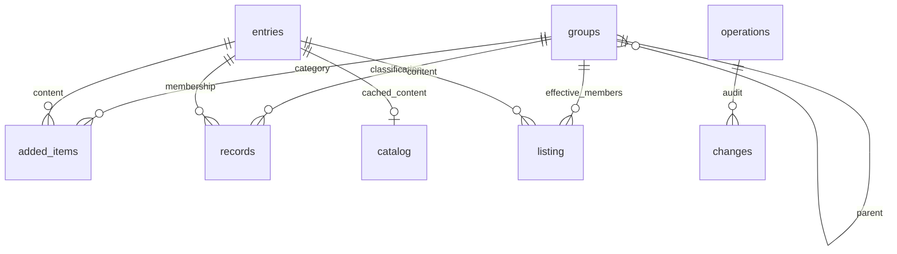

# 本地数据库与恢复

AppManager 使用 Windows 10/11 内置的 `winsqlite3.dll`，数据库位于数据目录的 `appmanager.db`。不需要安装数据库服务或下载第三方 DLL，构建目标为 x64。

## 升级与原数据

首次启动新版时，在完整事务中迁入 XML 的常用、隐藏、分类、集合、额外归属、排除项、排序、手动内容、桌面备份记录和界面设置。原 XML 不再作为写入目标，迁移原件另存为 `config.xml.before-sqlite`。迁移中断会撤销整个事务，下一次启动重新迁入；已有已迁移数据库时不会反复导入旧 XML。

旧版正在运行时，请先从托盘菜单“退出”，再执行：

```powershell
powershell -NoProfile -ExecutionPolicy Bypass -File .\tools\activate-database-build.ps1
```

脚本保留旧程序副本，再原子替换主程序。然后通过原入口启动。迁移后如果需要退回旧程序，先导出最新 `.ambak` 并保留完整数据库；原 `config.xml` 是迁移前状态。

## 表和关系

| 表 | 用途与约束 |
| --- | --- |
| `metadata` | 数据版本、迁移标识、配置修订号 |
| `groups` | 分类、集合的固定整数 ID；`key` 唯一，集合通过 `parent_id` 外键关联父分类 |
| `entries` | 内容固定整数 ID；扫描键/路径键唯一，改名或移动时可保留 ID |
| `added_items` | 手动收录的路径、显示名、类型及分类外键；内容与分类关系唯一，包含规范化路径索引 |
| `records` | 常用、隐藏、主分类覆盖、额外归属、排除关系、分类内顺序和偏好；关系指向内容/分类 ID，属性保存在局部 XML 字段中；主分类覆盖每内容至多一条 |
| `catalog` | 可重建的内容目录及文件元数据缓存，不存图片、视频或图标二进制 |
| `listing` | 可重建的有效分类成员及排序投影；分类和内容复合主键去重 |
| `operations` | 事务编号、UTC 时间、操作入口、用户、会话、进程、变更摘要、撤销关联 |
| `changes` | 同事务记录每行变更前后值，按事务和实体分别建立索引 |
| `write_context` | 当前写事务的审计上下文，禁止无审计上下文修改正式数据表 |



“全部软件/全部文件/全部资源”根据内容类型生成投影。“常用”根据收藏记录生成投影。集合可见成员取集合归属与父分类有效归属的交集；从父分类移除时保留集合关系，重新加入父分类后可恢复。分类和集合改名更新固定 ID 对应的名称，不改变成员外键。分类移除与磁盘删除是独立操作。

## 读取与写入

- 主列表每页最多 200 条，使用 `(rank, name, item_id)` 或排序列加内容 ID 的游标翻页，不使用深 OFFSET；相同名称有 ID 作为稳定次序。
- 分类、内容双向关系索引支持按分类读成员、按内容查归属。列表分别提供默认顺序、名称、大小、时间，以及显示/不显示隐藏项的覆盖索引。
- `added_items` 按需分批读取，内存缓存有上限；修改属性只登记变更项。按路径查收录记录走索引，系统软件扫描不把所有已登记文件展开到内存。
- 正式数据只执行新增、修改和删除的差量写入；未变化记录不重写。关系投影和操作日志在同一事务中更新，错误时整体撤销。
- `WAL` 支持读写并行，`synchronous=FULL` 保证提交落盘，外键开启，写锁最多等待 5 秒。应用写操作串行执行，修订号防止过期会话覆盖较新数据。
- 大小和时间在后台按批索引，排序在数据库中覆盖整个分类；尚未索引、文件缺失或网络路径等情况保留未知值。资源文件保留收录记录，缺失文件不会在扫描时被静默删除。
- 模糊搜索保留跳字匹配，结果分页。任意子串/跳字检索仍需扫描匹配范围，不承诺与精确分类索引相同的复杂度。

配置兼容层仍会读取分类、额外归属和排序等关系元数据；大体量手动内容已按需加载。极大规模的额外归属/显式排序仍会增加配置加载和差量比对成本。拖动排序只开放给一页内的分类，避免把一页的顺序误写成整个分类顺序。播放器浏览和批量选择以当前页为范围；迷你音乐播放列表按需读取。

## 排查、撤销和备份

入口：**设置 → 数据维护与操作记录**。

- 默认显示最近 200 条事务，可双击查看最多 100 条明细，或流式导出该事务全部变更。
- 操作日志保存在数据库中，默认不自动清理。失败尝试写入 `error.log`，不伪装成成功事务。
- 只允许撤销最新业务事务，防止覆盖后续修改；扫描登记不阻挡业务撤销。撤销会产生新事务，撤销这条撤销记录即为重做。历史 ID 注册表保留，未使用的 ID 不回收。
- 事务撤销恢复配置和关系。磁盘移动、回收站删除以及文件内容需要使用布局备份或文件备份恢复，数据库日志不承诺恢复物理文件。
- “完整备份”使用 SQLite 在线备份 API，包含 WAL 中已提交数据，并检查备份完整性；不能只复制正在运行的 `.db` 主文件。
- “恢复数据库”先保留当前完整数据库副本，再恢复所选快照并记录恢复事件；恢复前留底文件位于数据库旁，名称包含 `before-restore`。
- 布局备份继续保存 XML 和收纳目录，并附加完整数据库快照；布局恢复向当前数据库提交新的关系事务，保留当前审计链。
- 启动遇到损坏数据库时停止正常加载，可选择完整备份恢复；损坏主文件及其 WAL/SHM 会分别留底，名称包含 `before-recovery`。未知数据库及更高版本数据库会拒绝写入。

## 验证

```powershell
# 编译候选程序、运行核心自测及数据库回归
powershell -NoProfile -ExecutionPolicy Bypass -File .\build.ps1 -OutputPath "$env:LOCALAPPDATA\AppManager\AppManager.Database.exe"

# 另运行 30 万条数据验证（所有数据均在独立 TEMP 目录）
powershell -NoProfile -ExecutionPolicy Bypass -File .\build.ps1 -OutputPath "$env:LOCALAPPDATA\AppManager\AppManager.Database.exe" -ScaleDatabaseTests
```

数据库测试覆盖迁移、完整字段往返、固定 ID 改名、增删改与回滚、过期写入、写锁失败、事务中途失败与重试、进程异常退出、在线备份及恢复、损坏原件留底恢复、隐藏/排除/多归属、界面分页和全分类排序。

最终候选构建：核心自测 62/62、数据库常规测试 16/16 通过（包含迷你音乐读取和导出失败保护）；另有 30 万条规模测试通过。真实配置只复制到隔离目录后验证迁移，常用 21 条、手动内容 121 条、集合 2 个，语义比对通过。替换脚本已在临时目录验证旧程序留底及候选文件哈希一致，并确认运行中的旧程序会阻止替换；真实配置尚未迁移。

2026-10-30 本机 30 万条合成资源记录测试：首次导入约 163 秒；首屏约 66 ms；连续 100 页约 1.15 秒；单条额外归属保存约 99 ms；重新加载及完整性检查约 3.22 秒；数据库约 468 MiB（含逐行完整审计）。查询计划使用 `ix_listing_page` 覆盖索引，无临时排序。测试不包含实际文件搬运、媒体解码及网络文件访问，首次导入耗时包含全量索引与审计写入。

既有回归中的 DPI 工作区边界用例在原始 HEAD 和本次修改中均失败；该窗口/DPI 问题独立于数据库改动，未扩大修改范围。
